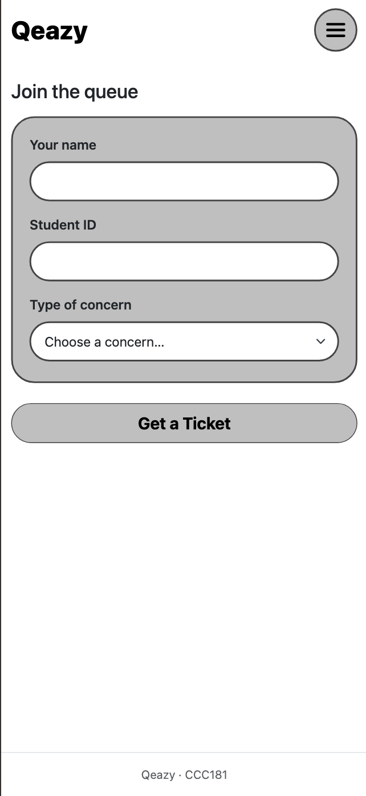
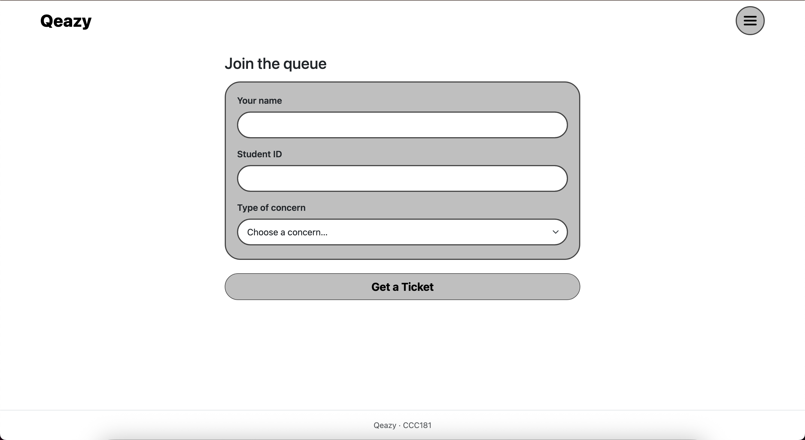
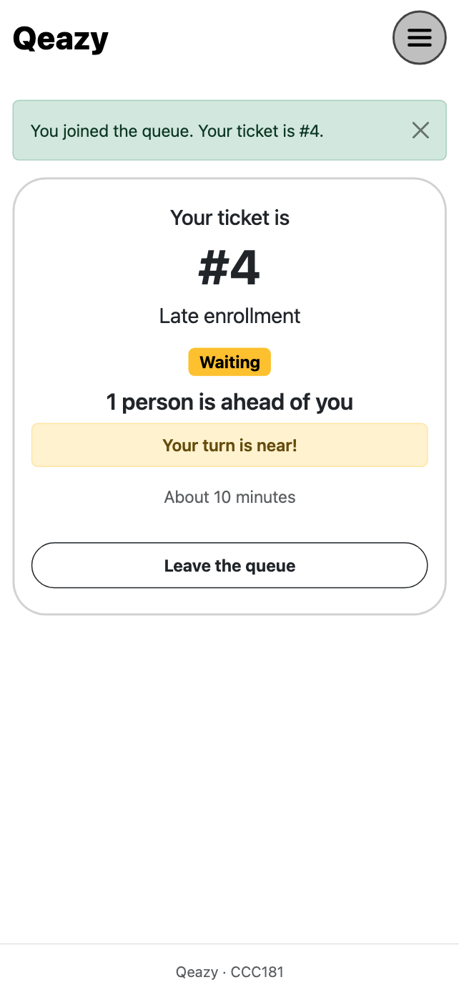
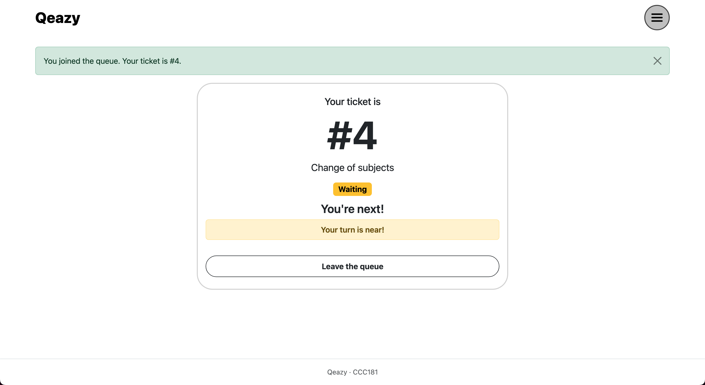
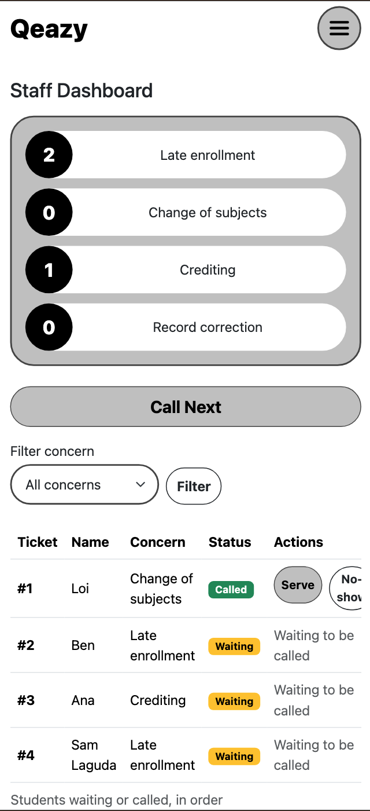
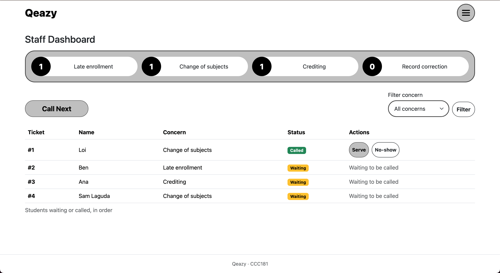

# Qeazy: Week 3 Report

## Title details

- **App:** Qeazy, a queue management web app for the registrar's in-person enrollment concerns
- **Setting:** School registrar office (hybrid: online portal and forms, in-person submission and special concerns)
- **Name:** Laguda, Sam Gabriel Benedict A.
- **Student ID:** 2024-1024
- **Section:** CS3A
- **Date:** 10/25/2026
- **Pull request:**: https://github.com/sgblaguda/CCC181/pull/3

## Personas

**Loi, the person waiting.** "Kapoy maglinya unya dili ra diay ka i-serve in the end kay sarado na diay." *(It's tiring to wait in line and then not be served because they're closing.)* Top tasks: check the forms needed (FR-05), join the queue from a phone (FR-01), see queue number, position and estimated wait (FR-02), get notified when the turn is near (FR-04).

**Rina, the staff member.** (Not from an interview), during the enrollment season I've observed that staff usually need to cater to students who aren't lined up in an orderly manner which makes their job hectic.

Full profiles: [personas.md](personas.md)

## Screens

| Screen | Phone | Laptop |
|---|---|---|
| Join |  |  |
| My place |  |  |
| Staff dashboard |  |  |

- **Join:** used by Loi on a phone, one-handed, to get a ticket for a concern (FR-01).
- **My place:** used by Loi, who glances at it between classes to see the ticket number, status and position (FR-02, FR-04).
- **Staff dashboard:** used by Rina at the counter (laptop) or on a phone when away from it, to call, serve or skip students (FR-03).

## Design decisions

1. **The ticket number is the biggest thing on My place.** Loi checks the page in short glances between classes, and her first rule is that the queue number, position and estimated wait must be large and on one screen.
2. **Call Next is the largest button at the top of the staff dashboard.** Rina uses it the most and has only seconds between students, so it is full width on a phone and one click on a laptop. Serve and No-show only appear for the student who has been called, so she cannot serve the wrong person.
3. **The join form has only three fields and no account.** Loi has one hand busy holding forms and is standing in a hallway, so the form needs few taps. The concern list matches the concerns in my wireframes (late enrollment, change of subjects, crediting, record correction).

I also kept the staff table on the phone (it scrolls sideways inside its own box) instead of the card layout in my staff phone wireframe, because it was simpler to build and the table still stays inside the page.

## Self-review

The main problems I found in my wireframes ([feedback.md](feedback.md)), and what I changed in the app:

- **My place:** the big number was labeled "position" when it is the ticket number, and "Your turn is near!" was always shown. In the app, the number is the ticket number, the position is a sentence ("11 people are ahead of you"), and the near alert only appears when the turn is close. Leave the queue now asks for confirmation.
- **Join:** the fields only had placeholder-style names. The app has visible labels above each input.
- **Staff dashboard:** called students were not marked and every row had Serve and No-show buttons. Called students now show first with a "Called" badge, and only they have the buttons. Labels are consistent ("No-show").

## Accessibility

Lighthouse accessibility scores (Mobile): Join 94, My place 92, Staff dashboard 97. Lighthouse listed no accessibility issues, so nothing needed fixing for the score. On my own I increased the small staff buttons to a 44 px minimum height and changed the focus outline to a blue one that is easier to see on white.
## Usability test

| Task | Finished? | Time | What happened |
|---|---|---|---|
| 1. Get in line for a concern | Yes | 11 seconds | n/a |
| 2. How many people are ahead, and what is your number? | Yes | 4 seconds | n/a |
| 3. As staff, call the next person and mark them served | Yes, with help. | 16 seconds | They hesitated in clicking the buttons for fear of deleting the whole table. |

## Reflection

Tickets are in a Python list that resets when the server restarts. When they move to PostgreSQL, ticket numbers should come from the database, statuses will persist, the wait estimate can use real average service times instead of my fixed 10 minutes per student, and I will need to protect against two students joining at the same time.

## Declaration

I used Claude for help with this activity, drafting starter code, templates, document outlines and first drafts of personas, and feedback from my proposal. I ran, tested and changed the code, and wrote the final versions of my documents. 