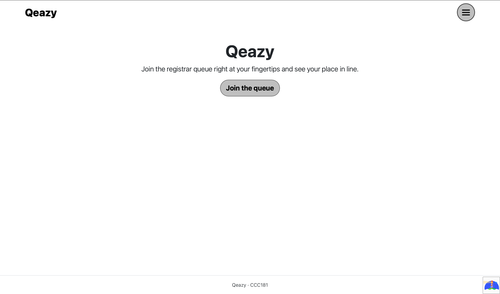
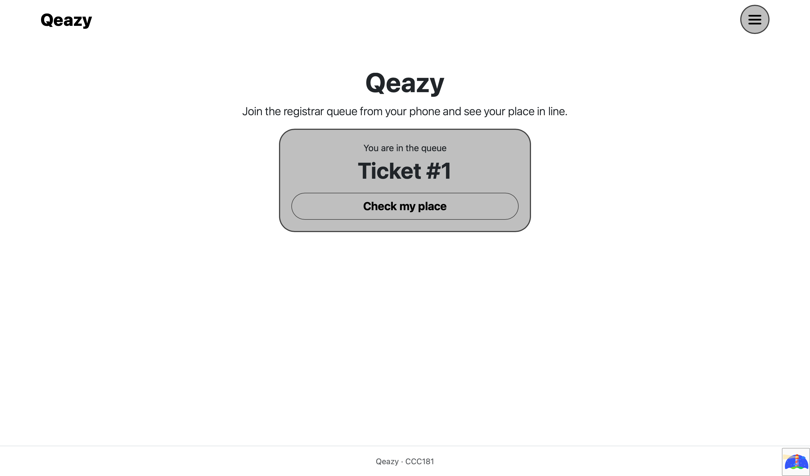

# Usability test: Qeazy

## Session details

- **Participant:** 3rd-year student, who has experienced the predicament of lining up in the registrar.
- **Persona they match:** Loi

- **Date, format and device:** 10/25/26, Face-to-face using a laptop.

## Tasks

I read each task out loud, one at a time, did not help, and asked them to think aloud.

| # | Task | Finished? (yes / with help / no) | About how long | Where they hesitated, what they said, what surprised me |
|---|---|---|---|---|
| 1 | "You just arrived. Get in line for [a concern, e.g. change of subjects]." | Yes, with no help. | 11 seconds | n/a|
| 2 | "How many people are ahead of you? What is your number?" | Yes, with no help.| 4 seconds| n/a  |
| 3 | "Pretend you are the staff member. Call the next person and mark them as served." | Yes, with help.| 16 seconds | They hesitated in clicking the buttons for fear of deleting the whole table.  |

## Persona rules: which held up and which did not

| "Because …, my interface must …" rule | Held up? | 
|---|---|
| Loi: show queue number, position and wait in large text on one screen | Yes| 
| Loi: let them join in 3 taps or fewer, with no account | Yes | 
| Loi: show the checklist before joining, work on weak data, keep their place on reload | Yes |
| Rina: make Call Next the easiest button and serve or skip in one click | Yes |
| Rina: show the queue, each concern and the waiting counts on one screen | Yes | 
| Rina: make No-show quick and keep the queue order fair and visible | Yes |

## Most serious problem

The participant said that they had no way to go back and check their ticket number after closing the myplace page.

## Improvement (10b)

- **Problem:** No way to go back to the myplace page.
- **Fix:**  Added a new button in the main page to check their place in the queue after exiting the queue screen. 
- **Before:** 
- **After:** 
