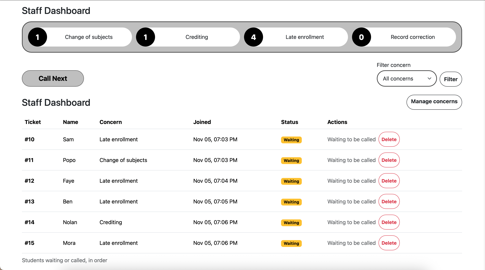
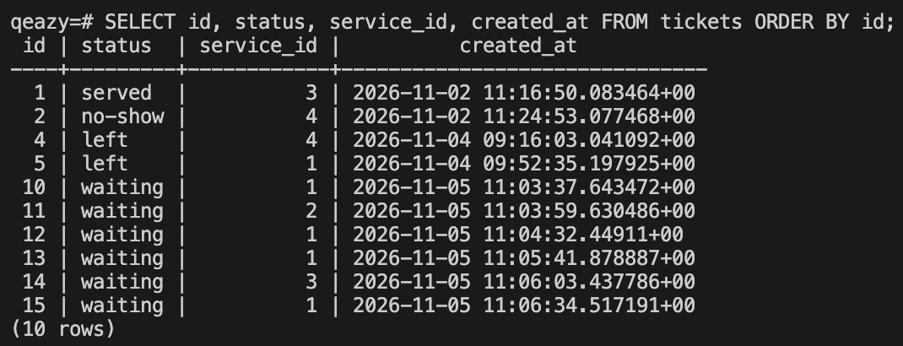
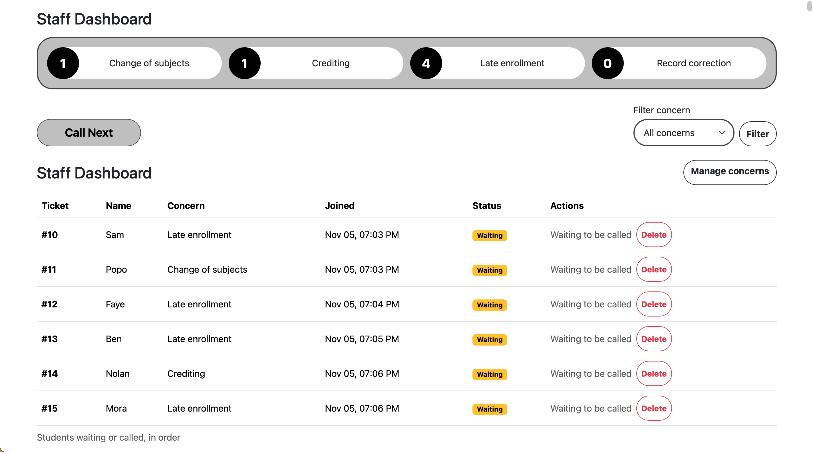
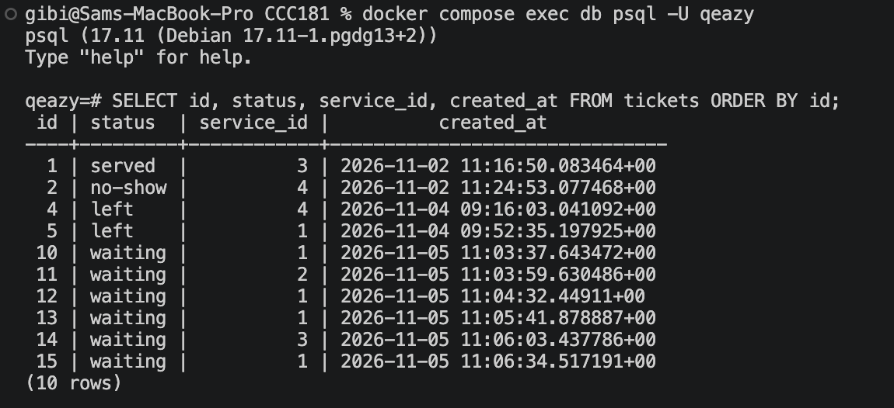

# Persistence proof

This tests NFR-05: no ticket is lost when the server or the database restarts.

## 11a. The restart test

1. I created at least five tickets across at least two concerns, called one, served one, and let one person leave.
2. Before the restart, I took a screenshot of the staff dashboard and ran this in psql:

   ```sql
   SELECT id, status, service_id, created_at FROM tickets ORDER BY id;
   ```

   
   

3. I stopped Flask with Ctrl+C, ran `docker compose down`, and ran `docker compose ps` to see that nothing was running.
4. I ran `docker compose up -d`, waited until `docker compose ps` said **healthy**, and started Flask again.
5. After the restart, I took the same screenshot of the dashboard and ran the same query:

   
   

**Result:** TODO (for example: "All N tickets, their statuses and their times were exactly the same after the restart.") TODO: say whether NFR-05 passed.

## 11b. Rebuild from scratch

This tests that my migrations can rebuild the whole database on any computer. It deletes all data, so I did it only after 11a.

```
docker compose down -v
docker compose up -d
flask --app app db upgrade
flask --app app seed
```

**Result:** Both migrations ran in order, `\dt` listed users, services and tickets, the seed added the four concerns, and I could open the app, see the concerns on the join form and join the queue.
