# Qeazy: Week 4 Report

## Title details

- **App:** Qeazy
- **Setting:** University registrar office
- **Name:** Laguda, Sam Gabriel Benedict A.
- **Student ID:** 2024-1024
- **Section:** CS3A
- **Date:** 11/05/2026
- **Database:** PostgreSQL 17 in Docker
- **Pull request:**: 

## Requirements

I wrote 16 functional requirements (4 marked ★ for the registrar setting) and 8 non-functional requirements in [docs/requirements.md](../requirements.md). FR-01 to FR-07 and NFR-01 to NFR-04 come from my Week 1 proposal and keep their IDs.

**MVP:** FR-01, FR-02, FR-03, FR-08 and FR-11, with NFR-02, NFR-05 and NFR-06. It is the smallest version that removes the not-knowing about the wait and keeps the queue fair.

**Checked with a real person:** Loi, student. They said: There was no visible way to check their place from the main page. I changed: Added a button to allow users to go back to the myplace page. (FR-12)

## ERD

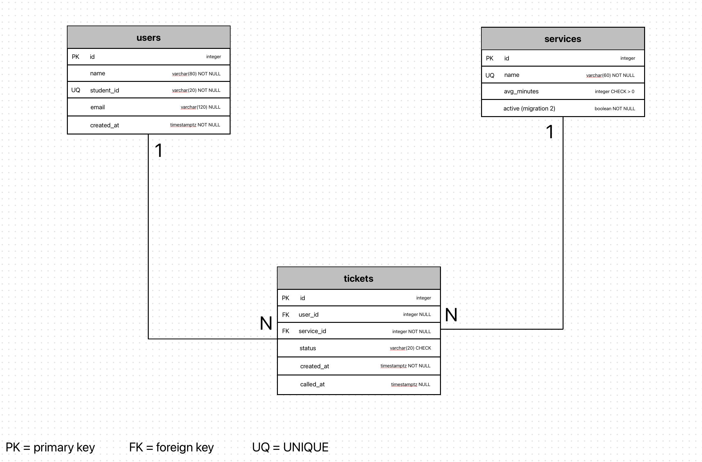

- One user has many tickets. Each ticket belongs to one user, or to none after the person has been removed.
- One service has many tickets. Each ticket belongs to exactly one service.

Full design, with every column, type and constraint: [schema.md](schema.md)

## Schema


```                                                 \d users
                                       Table "public.users"
   Column   |           Type           | Collation | Nullable |              Default              
------------+--------------------------+-----------+----------+-----------------------------------
 id         | integer                  |           | not null | nextval('users_id_seq'::regclass)
 name       | character varying(80)    |           | not null | 
 student_id | character varying(20)    |           | not null | 
 email      | character varying(120)   |           |          | 
 created_at | timestamp with time zone |           | not null | now()
Indexes:
    "users_pkey" PRIMARY KEY, btree (id)
    "users_student_id_key" UNIQUE CONSTRAINT, btree (student_id)
Referenced by:
    TABLE "tickets" CONSTRAINT "tickets_user_id_fkey" FOREIGN KEY (user_id) REFERENCES users(id) ON DELETE SET NULL
```

```                                                 \d services
                                     Table "public.services"
   Column    |         Type          | Collation | Nullable |               Default                
-------------+-----------------------+-----------+----------+--------------------------------------
 id          | integer               |           | not null | nextval('services_id_seq'::regclass)
 name        | character varying(60) |           | not null | 
 avg_minutes | integer               |           | not null | 10
 active      | boolean               |           | not null | true
Indexes:
    "services_pkey" PRIMARY KEY, btree (id)
    "services_name_key" UNIQUE CONSTRAINT, btree (name)
Check constraints:
    "ck_services_avg_minutes" CHECK (avg_minutes > 0)
Referenced by:
    TABLE "tickets" CONSTRAINT "tickets_service_id_fkey" FOREIGN KEY (service_id) REFERENCES services(id) ON DELETE RESTRICT
```

```                                                 \d tickets
                                       Table "public.tickets"
   Column   |           Type           | Collation | Nullable |               Default               
------------+--------------------------+-----------+----------+-------------------------------------
 id         | integer                  |           | not null | nextval('tickets_id_seq'::regclass)
 status     | character varying(20)    |           | not null | 'waiting'::character varying
 created_at | timestamp with time zone |           | not null | now()
 called_at  | timestamp with time zone |           |          | 
 user_id    | integer                  |           |          | 
 service_id | integer                  |           | not null | 
Indexes:
    "tickets_pkey" PRIMARY KEY, btree (id)
Check constraints:
    "ck_tickets_status" CHECK (status::text = ANY (ARRAY['waiting'::character varying, 'called'::character varying, 'served'::character varying, 'no-show'::character varying, 'left'::character varying]::text[]))
Foreign-key constraints:
    "tickets_service_id_fkey" FOREIGN KEY (service_id) REFERENCES services(id) ON DELETE RESTRICT
    "tickets_user_id_fkey" FOREIGN KEY (user_id) REFERENCES users(id) ON DELETE SET NULL
```

## Design decisions

1. **`student_id` is the unique key and the email is optional.** NFR-02 says a student joins with no account in 3 taps, and FR-13 makes the email optional, so the email cannot be required or unique. A student ID is a stable fact about the person, and it lets a returning student get a new ticket without a second account.
2. **`tickets.user_id` is nullable with `ON DELETE SET NULL`.** NFR-03 says personal records are deleted within 30 days, but the registrar head still needs the tickets for the daily counts in FR-06. The ticket stays and loses the person. Deleting a concern is `RESTRICT`, so its tickets cannot be erased by accident.
3. **Position in line is computed, not stored.** For FR-02 I count the waiting tickets with a smaller id for the same concern, so there is no position column to rewrite whenever someone joins or leaves. I count by the ticket id because it is unique and always in join order, so two students who join at the same instant can never tie (NFR-06).

## Self-review

The problems I found when adapting ClinicQ's tables, from [schema-review.md](schema-review.md):

- ClinicQ keys users by a required unique email, but my email is optional, so I used the student ID.
- Blocking the deletion of users with tickets conflicted with the 30-day privacy rule and with reports, so I used SET NULL.
- Ordering the queue by time could tie, so I count people ahead by ticket id.
- Leaving and not showing up were the same status in Week 3, but reports need them apart, so I added a `left` status. I did not add a `role` column, because no requirement stores staff yet.

## Migrations

- `843463c0bcf9_initial_tables.py`: creates the `users`, `services` and `tickets` tables with their keys, constraints and defaults.
- `0cb6d3649600_add_services_active.py`: adds the `active` column to `services`, so staff can switch a concern off without deleting it (FR-11).

## CRUD

| Operation | Route | Requirement | Screenshot |
|---|---|---|---|
| Create | `POST /join` | FR-01 | 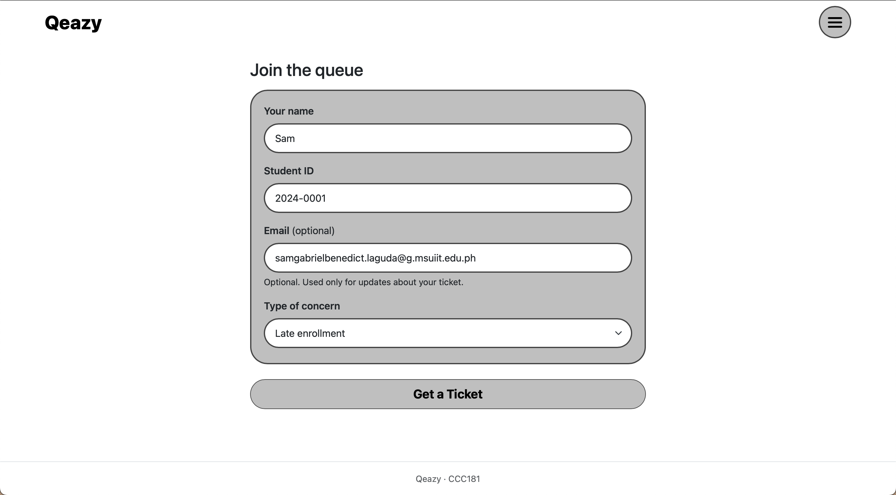|
| Read | `GET /queue/<id>` and `GET /staff` | FR-02, FR-09, FR-10 | 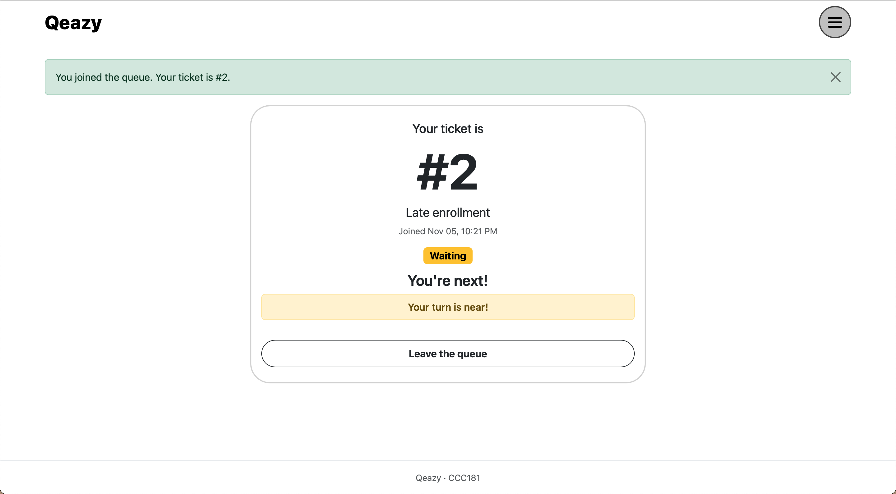 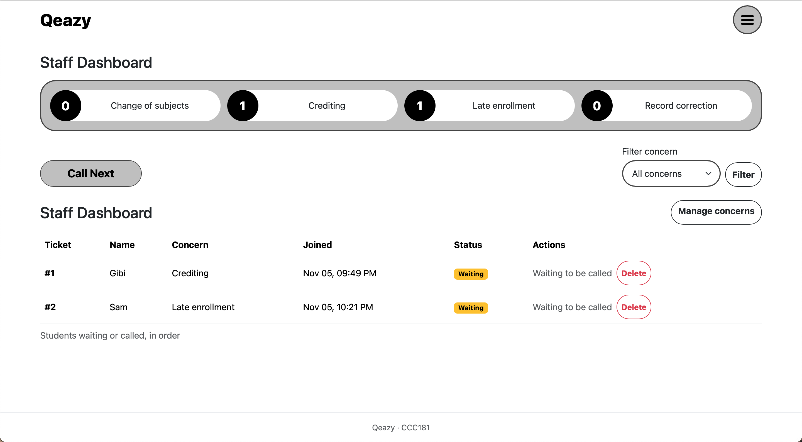
| Update | `POST /staff/call-next` and `POST /staff/tickets/<id>/<action>` | FR-03, FR-11 | 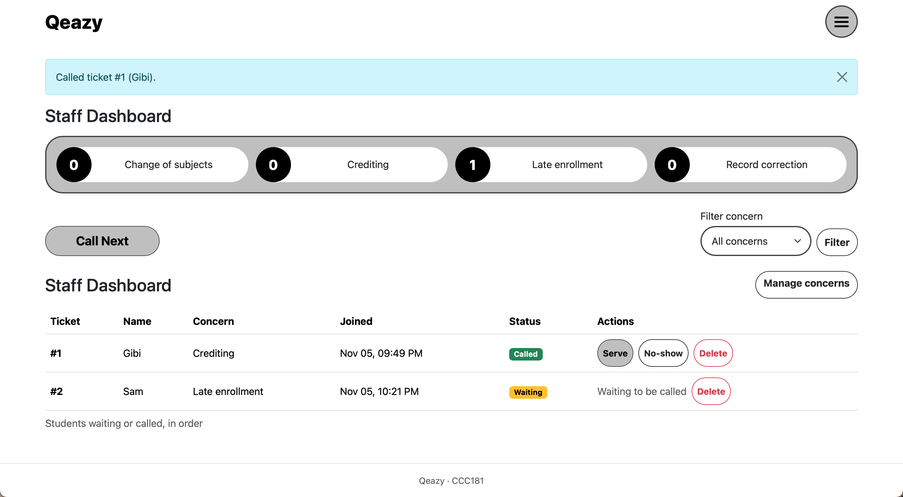 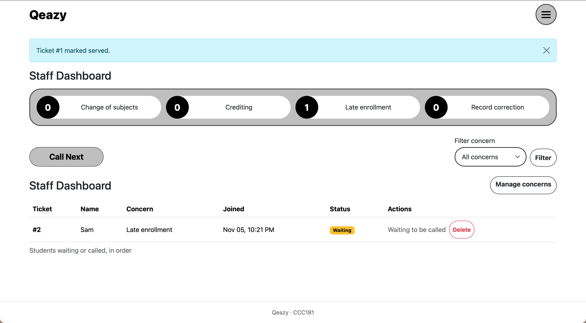 |
| Soft delete | `POST /queue/<id>/leave` | FR-08 | 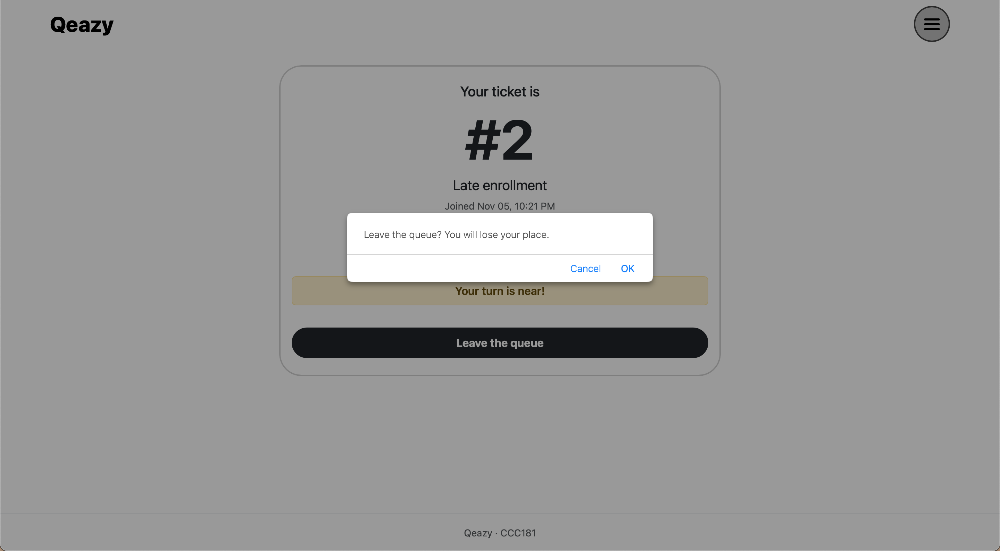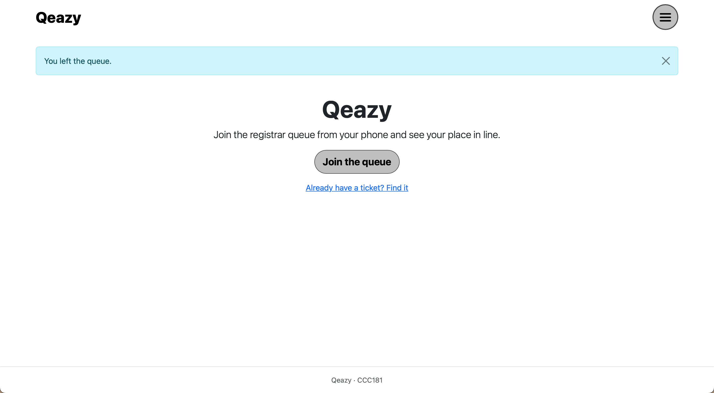 |
| Hard delete | `POST /staff/tickets/<id>/delete` | FR-14 | 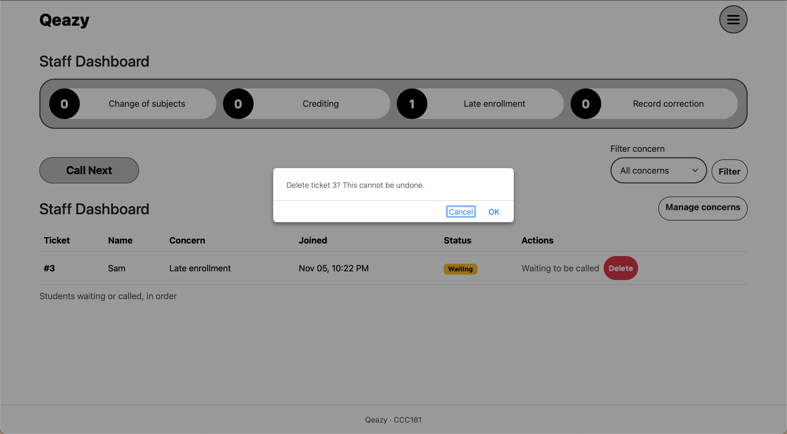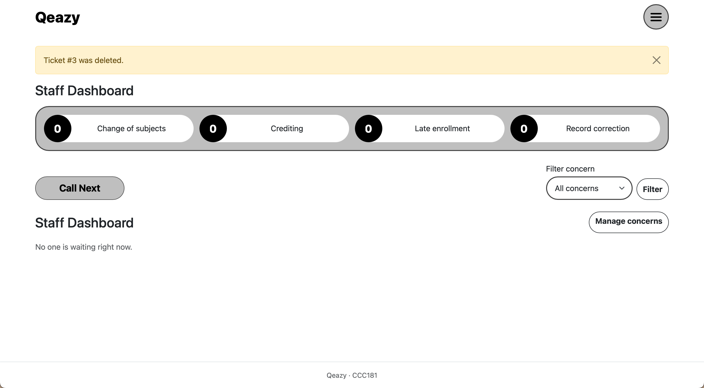 |


## Validation

Full results: [validation.md](validation.md). The browser, Flask and the database all check the data. Requests that skip the form get a 400 and save nothing, and every bad insert in psql fails with a clear error for each constraint type.

The PostgreSQL error I found most useful:

```
ERROR:  duplicate key value violates unique constraint "<variable>"
```

## Persistence

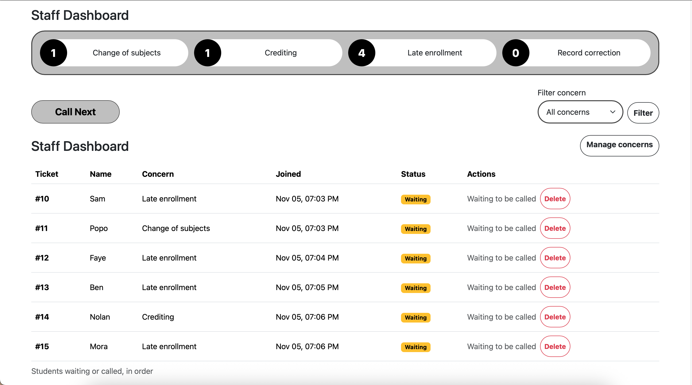
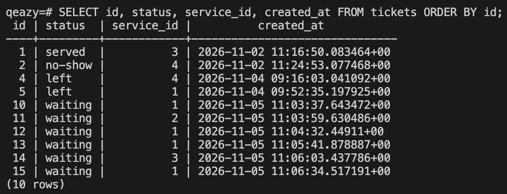

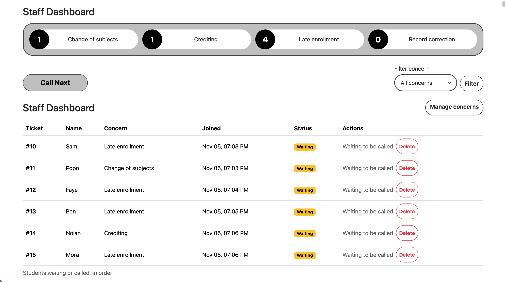
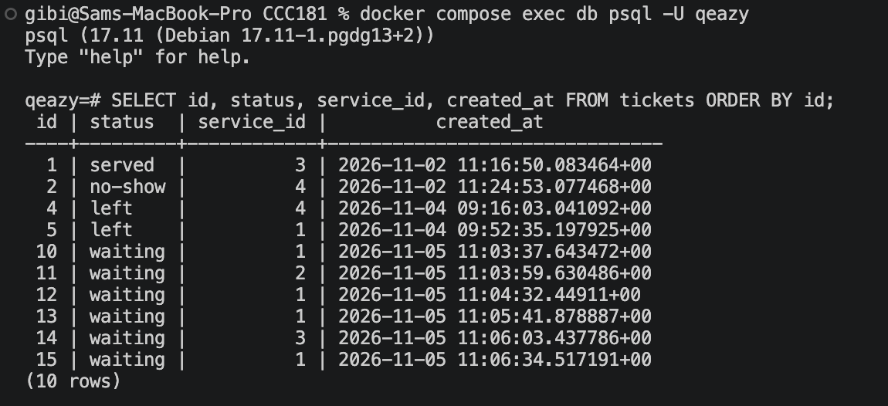

No ticket was lost on restart, NFR-05 is satisfied. Details: [persistence.md](persistence.md)

## Reflection

By far the most hardest part was the integration of PostgreSQL. Before, all the data was in a Python list, so connecting the app to a real database was learning several new things at once, running PostgreSQL in Docker, keeping the password out of Git with ```.env```, writing the models, and creating the tables with migrations.

**Hardest requirement to write in a testable way:** The hardest requirement was about not losing data when the database restarts (NFR-05).

A report the registrar head would want would be how many students left or did not show up before being served, per concern, per day. The `tickets` table has the status, the concern and the time joined, so this should be one grouped query.

## Declaration

I used Claude (Anthropic) for help with activities such as drafting the requirements, the models, Docker Compose file and routes, and first versions of my documents, adapted from the activity and my Week 3 app. I ran the commands, tested the app, checked the results and wrote my own results and screenshots. 