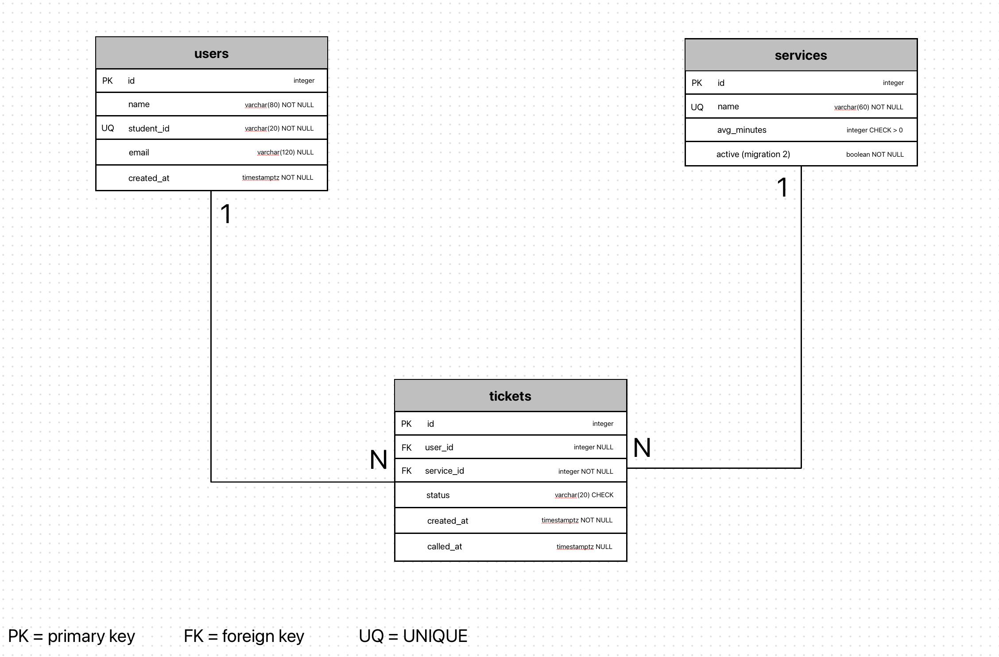

# Qeazy schema

I started from ClinicQ's three tables (`users`, `services`, `tickets`) and changed them for the registrar. In the interface a "service" is called a "type of concern"; I kept the table name `services` to match the code.

## 2a. Nouns in the requirements that store data

| Req ID | Requirement | Nouns | Table or column? |
| --- | --- | --- | --- |
| FR-01 | A **student** can join the **queue** for a **type of concern**. | student, queue, concern | users, *(queue is not a table)*, services |
| FR-02 | A student can see their **ticket number**, **status**, how many are **ahead**, and the **estimate**. | ticket number, status, ahead, estimate | tickets.id, tickets.status, *(computed)*, services.avg_minutes |
| FR-03 | Staff can call the next student, see their **concern**, and mark them **served** or **no-show**. | concern, status, time called | tickets.service_id, tickets.status, tickets.called_at |
| FR-08 | A student can leave the queue. | status | tickets.status = 'left' |
| FR-11 | Staff can add, rename and switch off a **type of concern**. | name, active | services.name, services.active |
| FR-12 | A student can find their ticket with their **ticket number** and **student ID**. | ticket number, student ID | tickets.id, users.student_id |
| FR-13 | A student can give an optional **email**. | email | users.email |
| FR-14 | Staff can delete a **ticket**. | ticket | tickets (row delete) |
| FR-16 | Personal details are removed after **30 days**; counts are kept. | date joined | users.created_at, tickets.user_id set to NULL |

- **The queue is not a table.** It is all tickets with status `waiting` for one service, ordered by when they joined.
- **Store facts, not results.** I store when a ticket was created and compute how many are ahead, because a stored position would need rewriting whenever someone joins or leaves.

## 2b. Tables and columns

| Table | Columns |
| --- | --- |
| `users` | id, name, student_id, email, created_at |
| `services` | id, name, avg_minutes, active |
| `tickets` | id, user_id, service_id, status, created_at, called_at |

- A student ID is a fact about the **person**, so it is in `users`.
- The concern is a fact about **this visit**, so `tickets` points to `services`.
- Average minutes is a fact about the **service**, so it is in `services`, not copied onto tickets.
- I did not add a `role` column or a staff table, because no requirement stores staff data yet. Staff accounts come with login in Week 11.

## 2c. Types and constraints

| Table | Column | PostgreSQL type | Constraint | Why |
| --- | --- | --- | --- | --- |
| users | id | integer, generated | PRIMARY KEY | Generated by the database, never reused |
| users | name | varchar(80) | NOT NULL | Staff need a name to call |
| users | student_id | varchar(20) | NOT NULL UNIQUE | One person per student ID; this is how a returning student is recognized |
| users | email | varchar(120) | nullable | The email is optional (FR-13), so it cannot be required or the key |
| users | created_at | timestamptz | NOT NULL DEFAULT now() | Needed for the 30-day deletion rule (FR-16); time zone safe |
| services | id | integer, generated | PRIMARY KEY | |
| services | name | varchar(60) | NOT NULL UNIQUE | No two concerns with the same name |
| services | avg_minutes | integer | NOT NULL DEFAULT 10, CHECK (avg_minutes > 0) | Rejects impossible waiting times |
| services | active | boolean | NOT NULL DEFAULT true | Lets staff switch off a concern without deleting it (FR-11); added by the second migration |
| tickets | id | integer, generated | PRIMARY KEY | The ticket number; the database guarantees no two are the same (NFR-06) |
| tickets | user_id | integer | FOREIGN KEY users(id), nullable | NULL after the person is removed, so the ticket stays for reports |
| tickets | service_id | integer | NOT NULL, FOREIGN KEY services(id) | No ticket for a missing concern |
| tickets | status | varchar(20) | NOT NULL DEFAULT 'waiting', CHECK (status IN ('waiting', 'called', 'served', 'no-show', 'left')) | Only these five states exist |
| tickets | created_at | timestamptz | NOT NULL DEFAULT now() | Set by the database when someone joins |
| tickets | called_at | timestamptz | nullable | Empty until staff call the ticket |

This schema uses PRIMARY KEY, FOREIGN KEY, NOT NULL, UNIQUE, CHECK and `timestamptz`.

## 2d. ERD

- One user has many tickets. Each ticket belongs to one user, or to none after the person has been removed.
- One service has many tickets. Each ticket belongs to exactly one service.
- Both foreign keys are on the "many" side, in `tickets`.

| Foreign key | On delete | Reason |
| --- | --- | --- |
| tickets.user_id → users.id | SET NULL | Personal details must be deleted after 30 days (NFR-03), but the registrar still needs the tickets for daily reports, so the ticket stays and loses the person. |
| tickets.service_id → services.id | RESTRICT | Deleting a concern must not erase its tickets. Staff switch it off with `active` instead. |

## 2e. Normalization

1. **One value per cell (1NF):** no column holds a list. The concern is one id, and the status is one word.
2. **Depends on the whole key (2NF):** there is no join table, and every column depends on its table's single `id`.
3. **No hidden copies (3NF):** a person's name, student ID and email are stored once in `users`, and a concern's name and average minutes once in `services`. Tickets point to them with ids, so a change is made in one row.